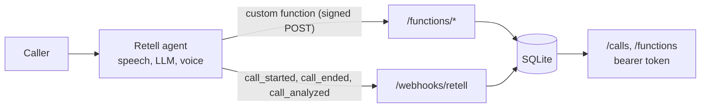

# Retell clinic voice agent

Backend for a voice receptionist built on [Retell AI](https://www.retellai.com). The agent answers calls for a fictional dental clinic and books appointments through two custom functions. A signed webhook receiver stores every call, and a small authenticated log viewer shows what happened on each one.

The project is built around the work a support engineer does with a customer: connecting the voice agent to their systems, then finding the cause when a call goes wrong.



## Features

- Custom functions `check_availability` and `book_appointment` with strict input validation and messages the agent can act on when something fails
- Signature verification on webhooks and function calls, using the raw request body
- Webhooks are persisted before they are acknowledged with a 204, and duplicate deliveries are ignored
- A deadline on bookings, so a request Retell has already given up on is not committed
- Every function call is logged with arguments, result, latency and error
- Log viewer endpoints protected by a bearer token that fails closed when unset
- Failure switches for practising incident response: slow lookups, upstream errors, time zone bugs

## Screenshots

Local test suite:


Log viewer after a simulated call. The call was produced by the signed-request test harness, not by a live agent:


## Quick start

Requires Python 3.9 or newer. No Docker needed.

```bash
git clone https://github.com/samuelnganga7933/retell-clinic-voice-agent.git
cd retell-clinic-voice-agent
python3 -m venv .venv
source .venv/bin/activate
pip install -r requirements-dev.txt
cp .env.example .env
```

Edit `.env`: set `RETELL_API_KEY` to the key that shows the webhook badge in the Retell dashboard, and generate an admin token:

```bash
python3 -c "import secrets; print(secrets.token_urlsafe(32))"
```

Then run the tests and start the server:

```bash
pytest -q
uvicorn main:app --reload --port 8000
```

Check `http://localhost:8000/health`, then expose the server so Retell can reach it:

```bash
ngrok http 8000
```

Retell blocks requests to localhost, so the dashboard needs the public HTTPS address from ngrok. The free address changes on every restart.

## Connect it to Retell

[docs/retell-setup.md](docs/retell-setup.md) walks through creating the agent, the prompt, the function schemas, the webhook and a browser test call. A phone number is not needed: Retell's web call test runs in the browser.

## Configuration

| Variable | Purpose | Default |
|---|---|---|
| `RETELL_API_KEY` | Key used to verify signatures. Must be the key with the webhook badge | required |
| `ADMIN_TOKEN` | Bearer token for `/calls` and `/functions`. Unset returns 503 | none |
| `CLINIC_TZ` | Time zone that slots are generated in | `America/Los_Angeles` |
| `VERIFY_FUNCTIONS` | Verify signatures on function calls too | `true` |
| `FUNCTION_DEADLINE_S` | Seconds a booking may take before it is refused. `0` disables | `5` |
| `FAIL_MODE` | `none`, `slow`, `error` or `tz_bug` | `none` |
| `SLOW_SECONDS` | Delay used by `slow` mode | `12` |
| `DB_PATH` | SQLite file | `clinic.db` |

## Endpoints

| Method and path | Auth | Purpose |
|---|---|---|
| `POST /functions/check_availability` | Retell signature | Open slots for a `YYYY-MM-DD` date |
| `POST /functions/book_appointment` | Retell signature | Book an exact `slot_id` for a patient |
| `POST /webhooks/retell` | Retell signature | Store `call_started`, `call_ended`, `call_analyzed` |
| `GET /calls`, `GET /calls/{id}` | Bearer token | Calls, transcripts and their function calls |
| `GET /functions` | Bearer token | Recent function calls with latency and errors |
| `GET /health` | none | Liveness check |

## Incident drills

Set `FAIL_MODE` in `.env` and restart the server.

| Mode | What the caller experiences | Where to look |
|---|---|---|
| `slow` | Long silence, then an apology or failed tool call | `latency_ms` in `/functions`, Retell's call log, the `appointments` table |
| `error` | The agent says scheduling is unavailable and offers a callback | `error` column, server traceback |
| `tz_bug` | Nothing visible on the call | Offset on `slot_id` values compared with `CLINIC_TZ` |

A worked example is in [docs/post-incident-ghost-booking.md](docs/post-incident-ghost-booking.md).

## Design notes

- Signatures are checked against the raw body. Re-serialising parsed JSON changes the bytes and breaks the hash.
- Slot IDs must match a generated slot exactly. Free text, off-grid times, weekends and past times are rejected, so a model error cannot create a bad appointment.
- Webhook events are keyed by event and call ID. Retell retries failed deliveries, so the same event can arrive more than once.
- `call_analyzed` arrives after `call_ended` and updates the same record.
- The log viewer contains transcripts and patient names, so it needs a token, and the API documentation routes are disabled.

## Project layout

```
main.py                  application
tests/test_api.py        tests with forged Retell signatures
docs/retell-setup.md     agent, prompt, functions and webhook configuration
docs/post-incident-*.md  incident write-up
docs/img/                screenshots
```

## License

MIT
