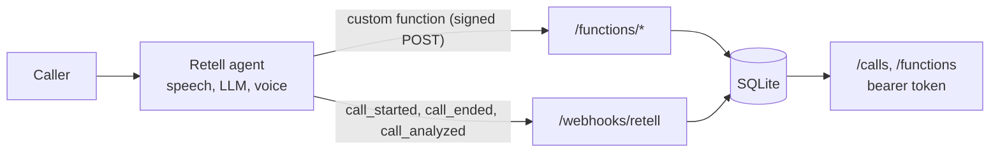
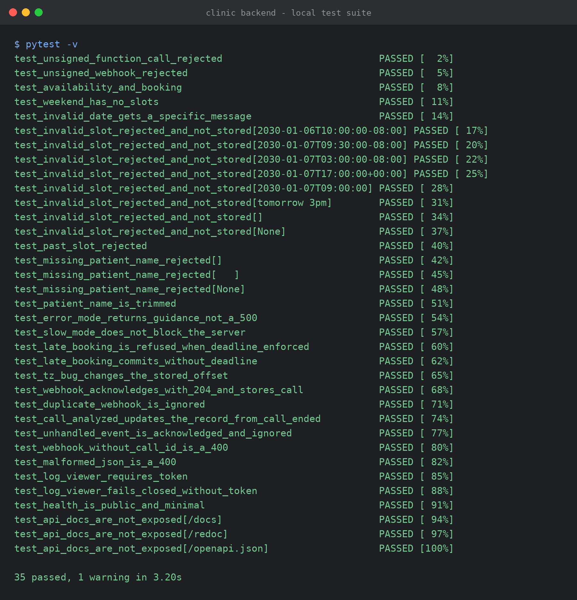
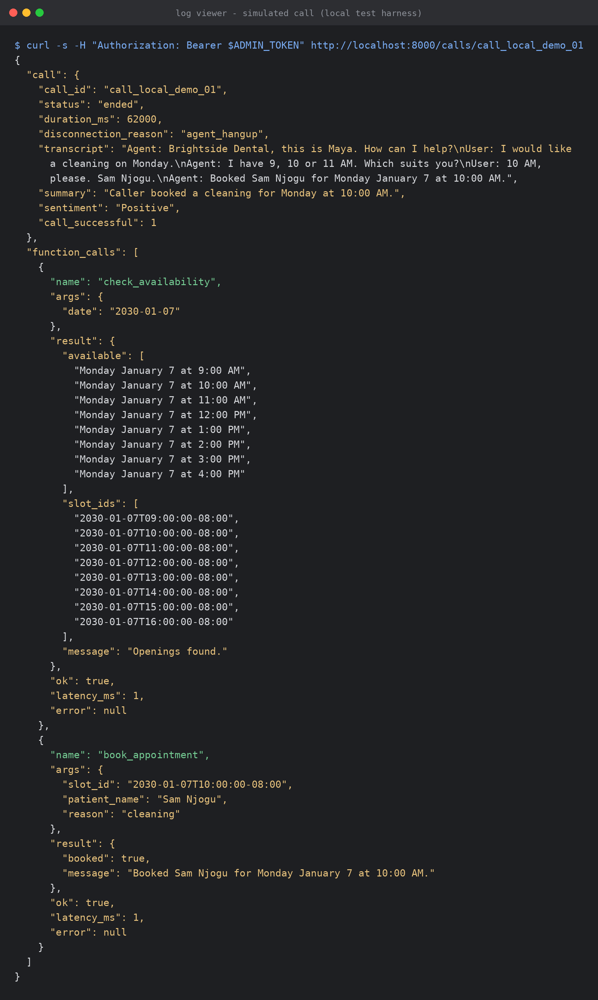
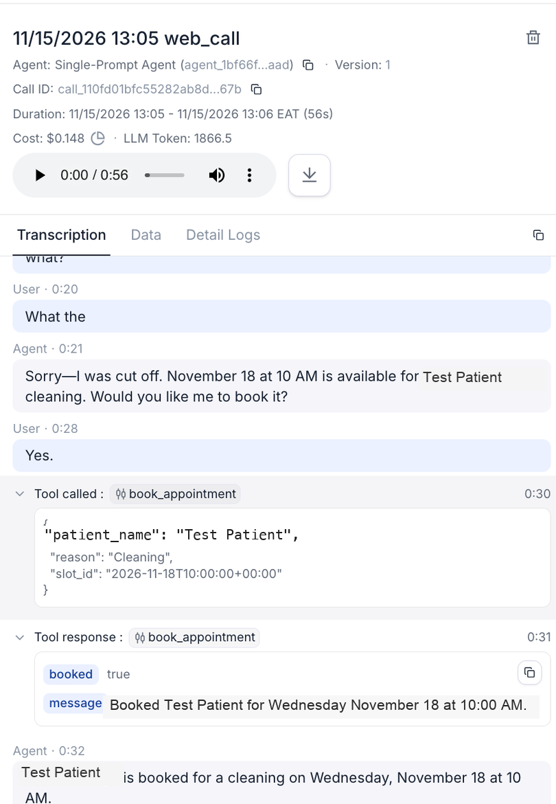
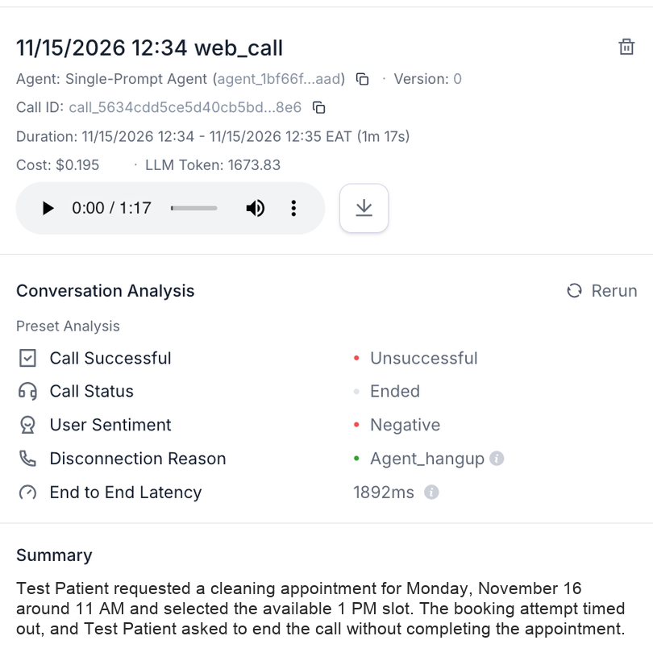

# Retell clinic voice agent

[](https://github.com/Samuelnganga7933/retell-clinic-voice-agent/actions/workflows/tests.yml)

A voice receptionist backend for a fictional dental clinic, built on [Retell AI](https://www.retellai.com). The agent answers calls, checks open times, and books appointments through signed custom functions. A signed webhook receiver stores every call, and an authenticated log viewer shows what happened.

The prompt, both tool contracts, and the backend were written from scratch. Retell provides the speech and LLM runtime; everything the agent calls is this repository.

The project is a support-engineering exercise: connect a voice agent to a real system, then find the cause when a call goes wrong.



## Scope

| Built here | Provided by Retell | Not built |
|---|---|---|
| System prompt, booking flow, and tool contracts | Speech recognition, LLM, and voice | PSTN/SIP telephony |
| `check_availability` and `book_appointment` | Call orchestration | Carrier phone numbers |
| FastAPI backend, SQLite schema, signature verification | Browser test call | Call transfer |
| Webhook receiver, duplicate suppression, log viewer | | |
| Booking deadline and failure drills | | |
| Tests and incident write-up | | |

## What it demonstrates

- Signed function calls and webhooks, with signature verification against the raw body
- Strict slot validation: exact `slot_id`, clinic time zone, weekdays only, no past times
- A booking deadline that refuses to commit work Retell has already given up on
- Webhook persistence before acknowledgement, with duplicate delivery protection
- Every function call logged with arguments, result, latency, and error
- A bearer-token log viewer that fails closed when no token is configured
- Failure switches for practising incident response: slow lookups, upstream errors, time zone bugs

## Screenshots

The local test suite, with no network calls and a throwaway database per test:



A call record and its function calls from the log viewer. This fixture was produced by the signed-request test harness, not by a live agent:



A live call transcript from the `tz_bug` drill. The `book_appointment` call stores `2026-11-18T10:00:00+00:00`, which is 2:00 AM in the clinic's time zone. Names are redacted:



A live call summary from the deadline drill. The agent reports the booking as unsuccessful after the function times out. Names are redacted:



## Quick start

Requires Python 3.9 or newer. No Docker needed.

```bash
python3 -m venv .venv
source .venv/bin/activate
pip install -r requirements-dev.txt
cp .env.example .env
```

Edit `.env`:

- `RETELL_API_KEY`: the key that shows the **webhook** badge in Retell. Other keys will fail signature verification.
- `ADMIN_TOKEN`: generate one with `python3 -c "import secrets; print(secrets.token_urlsafe(32))"`.

Run the tests, then start the server:

```bash
pytest -q
uvicorn main:app --port 8000
```

Check `http://localhost:8000/health`. It returns `{"ok":true}`.

Expose port `8000` over HTTPS with any tunnel. The free address changes whenever the tunnel restarts, so update both function URLs and the webhook URL together when it does. A request that never reaches the app leaves no server log to debug.

## Configuration

| Variable | Purpose | Default |
|---|---|---|
| `RETELL_API_KEY` | Key used to verify signatures. Must be the key with the webhook badge | required |
| `ADMIN_TOKEN` | Bearer token for `/calls` and `/functions`. Unset returns 503 | none |
| `CLINIC_TZ` | Time zone that slots are generated in | `America/Los_Angeles` |
| `VERIFY_FUNCTIONS` | Verify signatures on function calls too | `true` |
| `FUNCTION_DEADLINE_S` | Seconds a booking may take before it is refused. `0` disables | `5` |
| `FAIL_MODE` | `none`, `slow`, `error` or `tz_bug` | `none` |
| `FAIL_TARGET` | Which function the drill hits: `all`, `check_availability` or `book_appointment` | `all` |
| `SLOW_SECONDS` | Delay used by `slow` mode | `12` |
| `DB_PATH` | SQLite file | `clinic.db` |

`.env` is read once at import time. Restart the server after changing it.

## Agent contract

The system prompt, custom function schemas, webhook contract, and timeout rules are in [docs/agent-contract.md](docs/agent-contract.md).

The short version:

- `check_availability` takes a `YYYY-MM-DD` date and returns human-readable times plus exact `slot_ids`.
- `book_appointment` takes an exact `slot_id`, a patient name, and a reason.
- Both functions and `/webhooks/retell` require a valid `X-Retell-Signature`.
- Keep **Payload: args only** off so the handler can read the call ID.

## Endpoints

| Method and path | Auth | Purpose |
|---|---|---|
| `POST /functions/check_availability` | Retell signature | Open slots for a `YYYY-MM-DD` date |
| `POST /functions/book_appointment` | Retell signature | Book an exact `slot_id` for a patient |
| `POST /webhooks/retell` | Retell signature | Store `call_started`, `call_ended`, `call_analyzed` |
| `GET /calls`, `GET /calls/{id}` | Bearer token | Calls, transcripts, and their function calls |
| `GET /functions` | Bearer token | Recent function calls with latency and errors |
| `GET /health` | none | Liveness check |

Unsigned requests are rejected with `401 {"detail":"invalid signature"}`. That is the expected result, not a failure.

## Failure drills

Set `FAIL_MODE` and optionally `FAIL_TARGET` in `.env`, then restart the server.

| Mode | What the caller experiences | Where to look |
|---|---|---|
| `slow` | Long silence, then an apology or failed tool call | `latency_ms` in `/functions`, the Retell call log, the `appointments` table |
| `error` | The agent says scheduling is unavailable and offers a callback | `error` column, server traceback |
| `tz_bug` | Nothing visible on the call | Offset on `slot_id` values compared with `CLINIC_TZ` |

A worked example, including the before-and-after evidence, is in [docs/post-incident-ghost-booking.md](docs/post-incident-ghost-booking.md).

Set `FAIL_TARGET=book_appointment` for the ghost-booking drill. With the default `all`, `check_availability` is slowed too, so the agent times out before it can offer any times.

`FAIL_TARGET` only applies to `slow` and `error`. `tz_bug` ignores it because both functions build their slots from the same `slot_grid`, so the wrong offset appears on both paths.

### Live drill results

Browser test calls against the running agent on 2026-11-15. Every drill used a five-second Retell function timeout; the slow drills used `SLOW_SECONDS=12`.

| Drill | Call ID | Result |
|---|---|---|
| Baseline | `call_8405defc68ff6b9c04387f07da0` | booked, `ok=1`, `3ms`, row at Nov 17 2:00 PM |
| `slow`, deadline `0` | `call_ed63c3649180d22e9650e8c8761` | `ok=1`, `12006ms`, ghost row at Nov 17 1:00 PM |
| `slow`, deadline `4` | `call_5634cdd5ce5d40cb5bdb7e588e6` | `ok=0`, `12001ms`, no row, deadline error |
| `error` | `call_fb014f3302a40d920939ca6ba56` | `ok=0`, `0ms`, upstream error, no row |
| `tz_bug` | `call_110fd01bfc55282ab8d2f3df67b` | booked, `slot_id` ended `+00:00`; 10:00 UTC is 2:00 AM in the clinic's timezone |

## Testing

```bash
pytest -q
```

The suite makes no network calls. It forges valid Retell signatures and uses a temporary SQLite file per test. Coverage includes:

- unsigned function calls and webhooks rejected with `401`
- valid signatures accepted, including the raw-body requirement
- weekends, past dates, malformed dates, off-grid times, and missing names rejected
- the late-booking deadline: committed when disabled, refused when enforced
- `FAIL_TARGET` limiting the drill to one function, and rejecting an unknown value at startup
- slow mode not blocking the rest of the server
- webhook acknowledgement with `204`, duplicate suppression, and `call_analyzed` updates
- the log viewer requiring a token, and failing closed when the token is unset
- API documentation routes remaining disabled

## What broke while building this

These are real failures from building and testing the agent, kept here because they are the work.

- **401 on Retell's own requests.** The key in `.env` was a valid Retell key but not the one with the webhook badge, so signed traffic was rejected while unsigned probes were also correctly rejected. Using the webhook key and restarting the server fixed it. `.env` is read at import time.
- **A stale server on port 8000.** A leftover `http.server` answered health checks while uvicorn was not actually serving. The `drill config: ...` startup line is now the first thing to check before trusting a call.
- **Tunnel address drift.** Free tunnels change host on restart. The dashboard kept pointing at a dead address, so requests never reached the app and there was no server log to debug. Update all three URLs together.
- **Empty `args`.** Turning on **Payload: args only** sends the arguments bare. The handler reads `body["args"]`, so every call looked like an invalid date. Keep it off.
- **A drill that slowed the wrong function.** `FAIL_TARGET` defaults to `all`; a missing value made `check_availability` take 12 seconds, so the agent timed out before offering times. Set it explicitly.
- **Timeout units.** Retell's function timeout is in seconds. An early draft of the setup notes said `5000` ms; `5` is correct.

## Security notes

- Signatures are verified against the raw request body on both function calls and webhooks.
- The log viewer contains transcripts and patient names, so it requires a bearer token and fails closed (`503`) when `ADMIN_TOKEN` is unset.
- FastAPI's `/docs`, `/redoc`, and `/openapi.json` routes are disabled.
- `.env` and `*.db` are ignored. No key or patient database belongs in the repository.
- A public tunnel exposes the app to the internet. Use test data only, and stop the tunnel when you are done.

## Design notes

- **Raw body, not parsed JSON.** Re-serialising changes the bytes and breaks the HMAC.
- **Exact slot IDs.** The handler regenerates the slot grid and rejects anything that does not match. A model error cannot create a weekend, past, or off-grid appointment.
- **Idempotent webhooks.** Events are keyed by `(event, call_id)`. Retell retries failed deliveries, so the same event can arrive more than once.
- **Deadline below the platform timeout.** The handler measures its own elapsed time and refuses to commit after `FUNCTION_DEADLINE_S`. The write is what gets refused; the request itself has already been abandoned by the caller.
- **Non-blocking delay.** The `slow` drill uses `asyncio.sleep`, so one slow function does not freeze webhooks or other calls.
- **Latency is part of the record.** Every function call stores `ok`, `latency_ms`, and an error string, which is what makes disagreements between the platform log and the server log debuggable.

## Project layout

```text
main.py                       application
tests/test_api.py             tests with forged Retell signatures
docs/agent-contract.md        prompt, tool schemas, webhook and timeout contract
docs/post-incident-*.md       incident write-up with before/after evidence
docs/img/                     screenshots
.github/workflows/tests.yml   CI test run
```

## License

MIT. See [LICENSE](LICENSE).
